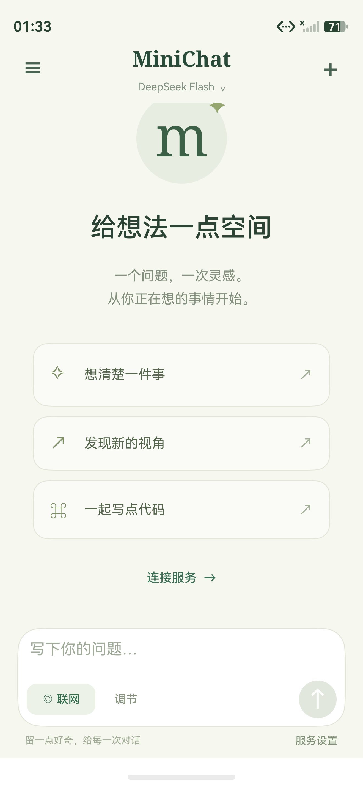
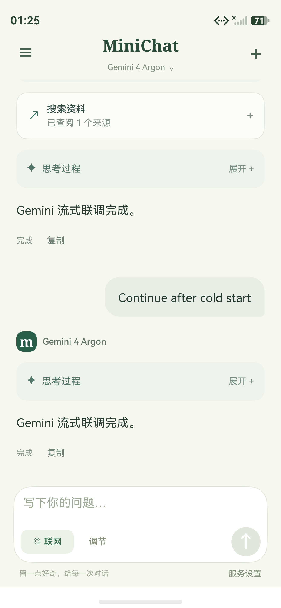

# 验证记录

日期：2026-11-07。项目：`/Users/chuh/Documents/test/minichat/chat`。验证使用本次实现的源代码和本地 HarmonyOS 6.1 SDK，设备为已连接的 HarmonyOS 手机模拟器。

## 已执行

| 检查 | 结果 | 证据 |
| --- | --- | --- |
| ArkTS 与 HAP 构建 | `assembleHap` 成功，0 个编译错误 | [编译日志](验证材料/编译日志.txt) |
| 核心协议、调度和存储 | 30 项测试通过 | [核心测试](验证材料/核心测试.txt) |
| 安装与冷启动 | unsigned HAP 安装成功，EntryAbility 启动成功 | 本次 HDC 输出 |
| 输入与发送 | 输入框可访问；键盘关闭后可发送，生成时可停止 | 本次 UI 树检查 |
| 模型选择 | Astra 可选 low / medium / high / xhigh / max；确认后创建 Astra 会话 | 本次 UI 断言 |
| DeepSeek 工具闭环 | 本地 Messages 服务返回结构化 search 调用；APP 请求工具并回传，然后显示回答 | [设备摘要](验证材料/设备联调摘要.json)、[会话样例](验证材料/模拟器会话样例.json) |
| OpenAI 工具闭环和流式状态 | 已观察思考中、工具运行、来源数量、回答中、完成 | [OpenAI 状态采样](验证材料/OpenAI流式状态.json) |
| Mercury 扩散 | 同一消息依次呈现草稿、较短修订、最终文本；终止空正文后最终文本保留 | [扩散帧采样](验证材料/Mercury扩散帧.json) |
| Gemini 工具闭环 | 原生 Parts / functionCall / functionResponse 完成往返，思考折叠展示 | [Gemini 状态采样](验证材料/Gemini流式状态.json) |
| Gemini 冷启动续聊 | 强制停止进程、重新启动、发送后续消息；测试服务收到原始函数签名、正文签名、空文本签名及工具结果 | [冷启动记录](验证材料/Gemini冷启动.json) |
| OpenAI 冷启动续聊 | 新请求保留 `store:false`、encrypted_content、assistant phase 和 function_call_output；响应完成 | 本次设备脚本断言及会话样例 |
| 密钥持久化 | 冷启动后的本地服务鉴权通过，使用此前从界面保存的测试密钥 | Gemini / OpenAI 冷启动断言 |
| 历史文件 | 实际设备会话文件为 13,580 字节，包含四家协议会话；重启可恢复并继续请求 | [设备摘要](验证材料/设备联调摘要.json) |
| 停止与重试 | Gemini 思考过程中停止，显示已停止、发送控件恢复；点击重新生成可继续 | 本次 UI 断言 |
| 会话隔离 | 原会话生成期间新建会话，采样期间新会话保持空白，旧会话完成后可从历史找回 | [切换隔离采样](验证材料/会话切换隔离.json) |
| 限流与失败 | 本地服务 HTTP 429 显示状态码和具体原因，同时提供重新生成 | 本次 UI 断言 |
| 无效密钥 | DeepSeek 官方服务对测试假密钥返回 HTTP 401，保留服务端错误详情 | 本次 HDC 读取的失败记录 |
| 删除交互 | 删除确认弹窗与取消操作已检查 | 实际删除测试取消，详见下文 |

本地测试服务使用固定协议样例和明确的假密钥。源码中的服务默认值为官方地址；测试服务只存在于独立脚本中。成功回复、工具闭环、扩散帧和冷启动回放的设备验证范围为 **模拟器与本地协议测试服务**。四家官方模型使用有效 API Key 的成功对话，以及官方 Search / Fetch 的付费调用，尚待用户配置可用密钥后验收。

## 核心测试范围

测试直接加载生产 `.ets` 文件，覆盖：

- SSE 所有字符分割位置、LF / CRLF、多行 data、注释和连接尾部缓冲；实际网络层解码器的 UTF-8 按字节分片。
- 状态码晚于 dataEnd、错误脱敏、无响应连接取消。
- DeepSeek 多工具参数分片、思考块及签名；OpenAI 加密思考、phase、并行参数关联与 incomplete；Gemini Part 顺序、独立签名、空摘要与安全阻断。
- Mercury 普通增量、全量文本修订、空中间帧、结束帧和工具前后生成阶段。
- 四家多轮工具闭环、保存后的协议回放；最多 4 个并行工具、调用 ID 去重、参数冲突、8 轮上限和缺少 DeepSeek 密钥时的降级。
- 工具 HTTP 失败作为工具结果回传；Fetch Markdown、来源元数据和截断标记。
- 超长 Unicode 历史、写入失败保持原文件、损坏主文件恢复备份后继续保存；密钥首次保存、更新、读取与移除。

## 构建提示与待验证项

- 当前构建有 13 条文件 API 的“可能抛出异常”静态提示；文件错误在页面的加载、保存调用处处理，并显示可读提示。
- 项目没有签名配置，因此输出 unsigned HAP。模拟器已安装运行；物理设备需要在 DevEco Studio 配置签名后安装验收。
- 自动审批拦截了一个按屏幕位置选取删除按钮的测试命令，指出它可能误选非空会话。随后取消删除弹窗，保留全部会话；实际删除后的设备持久化检查未执行。
- 联调过程中修复了消息卡片状态刷新、工具卡片刷新、多个弹层绑定冲突、确认按钮被系统关闭按钮遮挡、模型切换后的能力选项刷新，以及输入地址中重复协议前缀的校验。

## 交付状态

- 四家 Base URL 已恢复官方地址，从界面保存的测试密钥已清除，参见 [清理检查](验证材料/联调清理.json)。
- 本地协议测试服务已停止，设备测试端口转发已移除；联调会话保留。
- 当前安装包 SHA-256：`9f815c60313d38043982c7b42c45a24c684600ff953c9731379286f9e48573b3`。

## 界面记录

下图为本地协议测试服务的 Gemini 对话，用于展示界面与状态：

